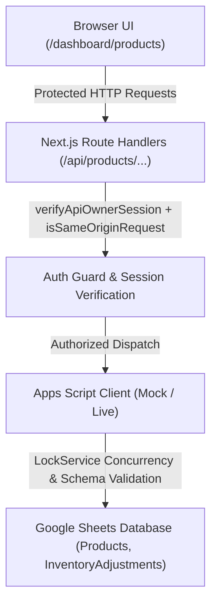

# Phase 6 — Core Inventory & Product Management

## Overview

Phase 6 implements the first core functional business module of the General Store Management System: **Product Management & Inventory Foundations**.

The system enables store owners to manage product catalogs, pricing, barcode/SKUs, live inventory counts, low-stock alerts, and stock adjustments with full audit trails.

---

## Architecture & Data Flow



---

## Key Capabilities

### 1. Protected Product UI (`/dashboard/products`)
- **KPI Summary Cards**: Real-time counts of Total Products, Active Products, Low Stock alerts, and Out of Stock items.
- **Search & Filtering**: Instant search across product names, SKU/barcodes, and categories. Filter pills for All, Active, Low Stock, and Inactive items.
- **Full Bilingual Support**: English and Nepali localization for all labels, hints, and feedback messages.
- **Responsive Layout**: Designed for mobile and desktop store workflows with rich aesthetic cards and interactive table rows.

### 2. Product Creation & Editing
- **Metadata**: Product Name (required), Category (with datalist suggestions), Measurement Unit (`piece`, `packet`, `kg`, `gram`, `litre`, `bottle`, `metre`), and optional Barcode/SKU.
- **Financial Precision**: All monetary values (`selling_price`, `cost_price`) are stored as **integer Paisa** (1 NPR = 100 Paisa). Form inputs accept Rupees with up to 2 decimal places and convert cleanly to integer Paisa.
- **Live Margin Tracking**: Real-time profit amount and margin percentage (`(Selling - Cost) / Selling * 100%`) displayed during data entry with visual warnings if selling price is below cost price.
- **Unit Precision**: Continuous units (`kg`, `litre`, `metre`) permit up to 3 decimal places; discrete units (`piece`, `packet`, `bottle`) enforce whole numbers.
- **Soft Deactivation**: Products can be deactivated (`is_active: false`) instead of hard deletion to preserve transaction history and referential integrity.

### 3. Stock Adjustment & Audit Ledger
- **Adjustment Types**:
  - `restock` / Intake (+)
  - `damage` / Expired write-off (-)
  - `correction` / Audit shelf count (sets exact inventory count)
  - `increase` / Manual increase (+)
  - `decrease` / Manual decrease (-)
- **Non-Negative Invariant**: Adjustments resulting in negative stock quantities are strictly rejected.
- **Audit Trail (`InventoryAdjustments` sheet)**: Every stock change records:
  - `adjustment_id` (UUID v4)
  - `product_id`
  - `adjustment_type`
  - `quantity_change`
  - `previous_stock`
  - `new_stock`
  - `reason` (mandatory)
  - `notes` (optional)
  - `actor` (username of operator)
  - `idempotency_key` (mandatory unique submission token)
  - `created_at` (ISO 8601 UTC)
- **Server-Enforced Idempotency & Recovery**:
  - The backend requires a valid `idempotency_key` for every stock adjustment.
  - Replayed requests with the same key return the recorded adjustment without double-mutating inventory.
  - If a prior write partially succeeded before an unexpected interruption, the backend self-heals by reconciling product stock to `new_stock`.

---

## API Routes

| Endpoint | Method | Description | Protection |
|---|---|---|---|
| `/api/products` | `GET` | List products with search, category, status, low-stock filter, and pagination | Owner Session |
| `/api/products` | `POST` | Create a new product record | Owner Session + Same-Origin |
| `/api/products/[id]` | `GET` | Retrieve product details with its full adjustment history | Owner Session |
| `/api/products/[id]` | `PATCH` | Update product fields or toggle active status | Owner Session + Same-Origin |
| `/api/products/[id]/stock` | `POST` | Perform stock adjustment with reason and audit logging | Owner Session + Same-Origin |

---

## Verification & Test Suite

The test suite in [`tests/products-and-inventory.test.ts`](file:///d:/1%20project/0codes/Project_neo/general-store/tests/products-and-inventory.test.ts) provides automated coverage for:
1. **Input Validation**: Discrete vs continuous unit validation, integer Paisa constraints, required name, and stock adjustment parameters.
2. **Backend CRUD Operations**: Product creation, SKU uniqueness check, get details, partial updates, and soft status toggles.
3. **Filter & Search**: Case-insensitive search across name, SKU, and category; filtering by active, inactive, and low-stock; KPI calculation.
4. **Stock Adjustment & Ledger**: Quantity change calculation, audit ledger row creation, and idempotency key deduplication.
5. **Financial Conversion**: Paisa-to-rupee and rupee-to-paisa mathematical precision and bilingual currency formatting (`रु` / `Rs.`).
6. **API Security**: 401 Unauthorized verification for all unauthenticated API requests.

Run tests:
```bash
npm test
```
